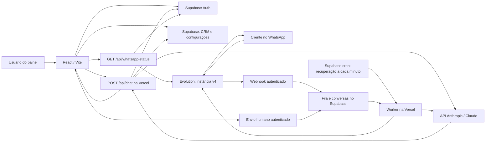

# Como o código funciona hoje

A aplicação tem um painel React/Vite, login e banco Supabase e funções HTTP na Vercel. A agente padrão é Felipa. A Evolution entrega mensagens por webhook; uma fila persistida controla respostas do Claude e envios de texto, respeitando a whitelist e o atendimento humano.

## Login e dados comerciais

`src/App.tsx` e `src/components/Auth.tsx` controlam entrada, cadastro, confirmação e recuperação. `src/lib/workspace.tsx` carrega e grava contatos, oportunidades, reuniões, agentes, conhecimento e conversas no Supabase. Cada conta tem seus próprios registros; as políticas RLS do banco reforçam esse isolamento.

O modo demonstração usa apenas o armazenamento do navegador e não chama Claude. Ele também não migra seus exemplos automaticamente para uma conta real.

## Configuração de agentes

`src/pages/Agents.tsx` salva nome, empresa, apresentação, instruções comerciais, modelo Claude, estado ativo e limiar de qualificação. O nome padrão é Felipa. O limiar serve de referência para qualificação manual; a IA não altera scores, pipeline ou reuniões sozinha.

O editor tem cabeçalho e ações fora da região de rolagem. Os campos rolam dentro do espaço disponível na tela, mantendo Cancelar e Salvar agente acessíveis.

## Uma resposta da Felipa

1. O painel envia mensagem, identificador do agente e, quando existe, da conversa para `POST /api/chat`, junto da sessão Supabase.
2. `api/chat.ts` valida a requisição. `server/chat.ts` autentica a pessoa, busca somente o agente/conversa/conhecimento dessa conta e confirma se o atendimento está ativo.
3. O servidor monta o contexto com identidade e instruções do agente, conhecimento em texto e histórico recente. A base é enviada como contexto; esta versão não usa busca vetorial nem leitura de PDF.
4. O banco reserva uma tentativa na quota persistida. O padrão é 50 tentativas por conta por dia UTC, configurável no servidor.
5. `server/anthropic.ts` chama Claude com a chave privada da Vercel e limite de saída. O servidor registra os tokens retornados pelo provedor.
6. Em conversa salva, a pergunta e a resposta são gravadas juntas. No Playground, o consumo é registrado, mas o histórico de teste é mantido na tela.

Ao assumir uma conversa como humano ou encerrá-la, a IA deixa de responder. Há nova verificação antes da gravação para respeitar uma mudança de atendimento ocorrida durante a chamada ao Claude.

As chaves Anthropic e service role ficam no servidor. O navegador recebe somente a configuração pública Supabase. `GET /api/health` informa presença de configuração, sem autenticar os serviços; por isso mantém `verified: false`.

## Estado da Evolution API

Em 30/10/2026, a inspeção confirmou os nomes cadastrados:

| Local | Variável | Estado observado |
| --- | --- | --- |
| Ambiente Codex | `WHATSAPP_EVO_TOKEN` | Vínculo pronto, destino permitido `ai.v4oliveira.com.br` |
| Vercel principal `swift-coral-qbz2f6f` | `WHATSAPP_TOKEN_EVO` | Sensitive, Production |
| Cópia reivindicada `swift-orbit-3oo3d8l` | Nenhuma variável WhatsApp | Ausente na inspeção |

`server/evolution.ts` aceita os dois nomes para a chave; `WHATSAPP_EVO_TOKEN` tem precedência. A chave existente na Vercel foi preservada. O servidor usa `WHATSAPP_EVO_URL=https://evo.madebyfelipe.agency`. O usuário informou `V4`; a verificação encontrou o nome real `v4`, em minúsculas, que passou a ser o valor de `WHATSAPP_EVO_INSTANCE`.

Em Integrações, o botão **Verificar conexão** chama `GET /api/whatsapp-status` com a sessão Supabase. O endpoint autentica o usuário antes de consultar `GET /instance/connectionState/v4` no servidor Evolution, usando o cabeçalho privado `apikey`. Se um nome retornar 404, o cliente verifica somente uma variação única de maiúsculas/minúsculas do nome configurado; não seleciona uma instância diferente. HTTPS é obrigatório, redirecionamentos não são seguidos e toda a consulta compartilha um prazo de 15 segundos. A resposta contém apenas instância, estado e indicadores; não retorna telefone, QR, chave ou payload completo do provedor. O modo demonstração não faz essa consulta.

O servidor Evolution respondeu por HTTPS e informou versão 2.3.4. A consulta autenticada pela Vercel confirmou `instance: "v4"`, `state: "open"` e `connected: true`, em 30/10/2026. Essa é uma observação do estado naquele momento; o botão permite consultar novamente. A conta temporária de verificação foi removida. Consulte [VALIDATION.md](VALIDATION.md).

O segredo de rede do Codex está limitado ao domínio da aplicação. A consulta real usa a chave já cadastrada no servidor Vercel, sem extrair o segredo do proxy. Uma chamada direta do Codex à Evolution exigiria habilitar o hostname no vínculo existente. Esse vínculo não configura automaticamente o servidor Vercel.

Uma sessão `open` descreve a conexão da instância. `messagingEnabled` consulta também o vínculo habilitado e o webhook verificado. `/api/health` indica apenas presença das configurações. A conexão do número depende da sessão Evolution; uma queda dessa sessão impede novos envios até reconectar.

## Mensagem recebida pelo WhatsApp

1. `api/whatsapp-webhook.ts` exige o segredo do cabeçalho antes de acessar o banco. `server/whatsapp-events.ts` aceita apenas a instância configurada, conversas individuais e eventos suportados. Não grava a chave que a Evolution pode incluir no payload.
2. A RPC `whatsapp_ingest` cria/vincula contato e conversa e salva mensagem e tarefa numa transação. O ID externo impede duplicação. O vínculo da instância fixa o dono e a agente; o remetente não escolhe outra conta.
3. Só um texto de número na whitelist pode entrar em atendimento IA. A lista atual representa dois números autorizados, terminados em **8747** e **1111**, nas formas brasileiras com/sem nono dígito. Outros remetentes, áudios e anexos ficam para humano; grupos e eventos anteriores à ativação não iniciam respostas.
4. `server/whatsapp-bridge.ts` obtém uma tarefa com lease e bloqueio por conversa. Consulta agente, histórico e conhecimento da conta, reserva quota e chama Claude. A resposta fica salva antes do envio.
5. O banco verifica novamente whitelist, agente e intervenção humana. `server/whatsapp-provider.ts` envia o texto à Evolution. O ID do provedor confirma aceite, sem significar entrega ou leitura.
6. `/api/whatsapp-worker` usa segredo próprio. A execução continua com `waitUntil` e encadeia tarefas disponíveis; `pg_cron`/`pg_net` no Supabase recuperam a fila a cada minuto, com segredo no Vault. Não depende de manter Codex aberto.

Falhas antes de enviar permitem retentativa limitada. Um resultado ambíguo depois de iniciar o envio fica como **envio não confirmado**, sem repetição automática. Ecos da Evolution confirmam envios conhecidos e não geram outra resposta. A fila mantém a ordem por conversa.

## Atendimento humano no WhatsApp

A Caixa de entrada atualiza a cada cinco segundos quando visível. **Assumir como humano** cancela respostas automáticas pendentes; **Enviar pelo WhatsApp** usa `/api/whatsapp-send`, valida o dono e enfileira o texto com identificador idempotente. Uma mensagem manual reconhecida no aplicativo WhatsApp também pausa a IA. Uma mensagem já encaminhada ao provedor pode chegar durante a troca de atendimento.

**Retomar IA** permite responder às próximas mensagens se o número continuar na whitelist e a agente estiver ativa. O agente não tem ferramentas para iniciar campanhas, alterar CRM ou agendar sozinho. Áudio e anexos são indicados no histórico e precisam ser abertos no WhatsApp; não há transcrição ou download de mídia.

O webhook anterior apontava para n8n e foi substituído pelo painel após autorização explícita. Sua configuração está preservada em `whatsapp_webhook_backup`, sem acesso pelo navegador. Consulte [WHATSAPP.md](WHATSAPP.md) para operação, segredos, retentativas e restauração.

Consulte [ACTIVATION.md](ACTIVATION.md) para o destino de produção e [VALIDATION.md](VALIDATION.md) para as verificações realizadas.
